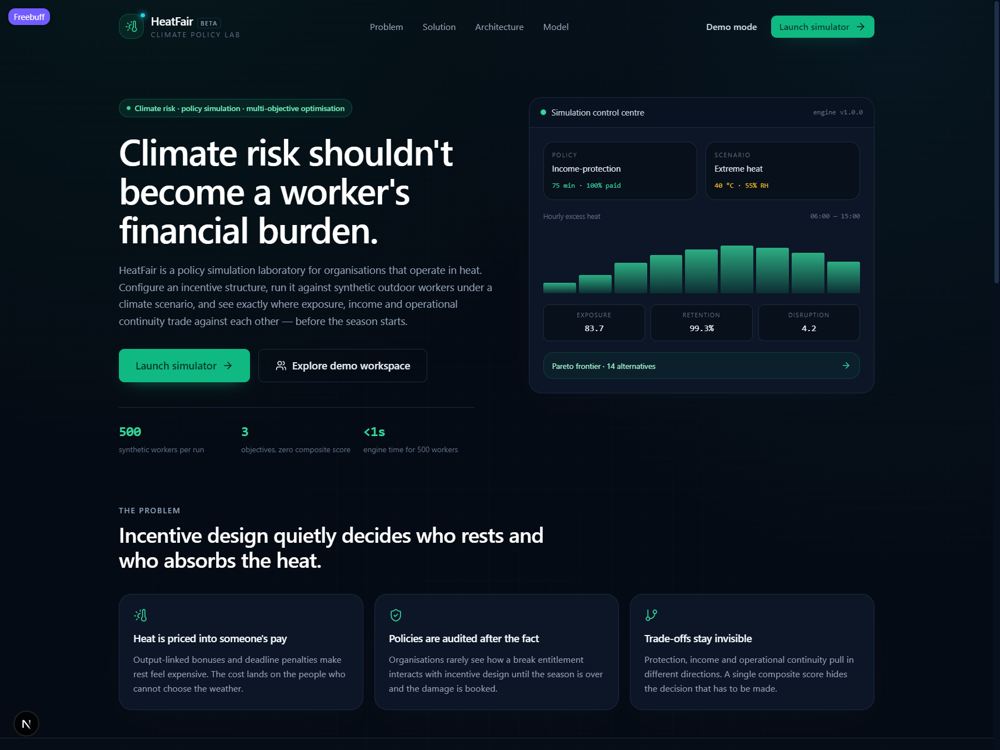
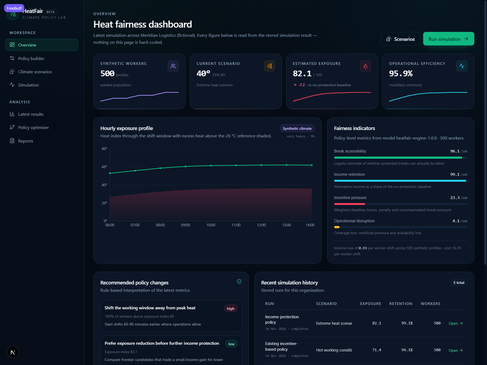
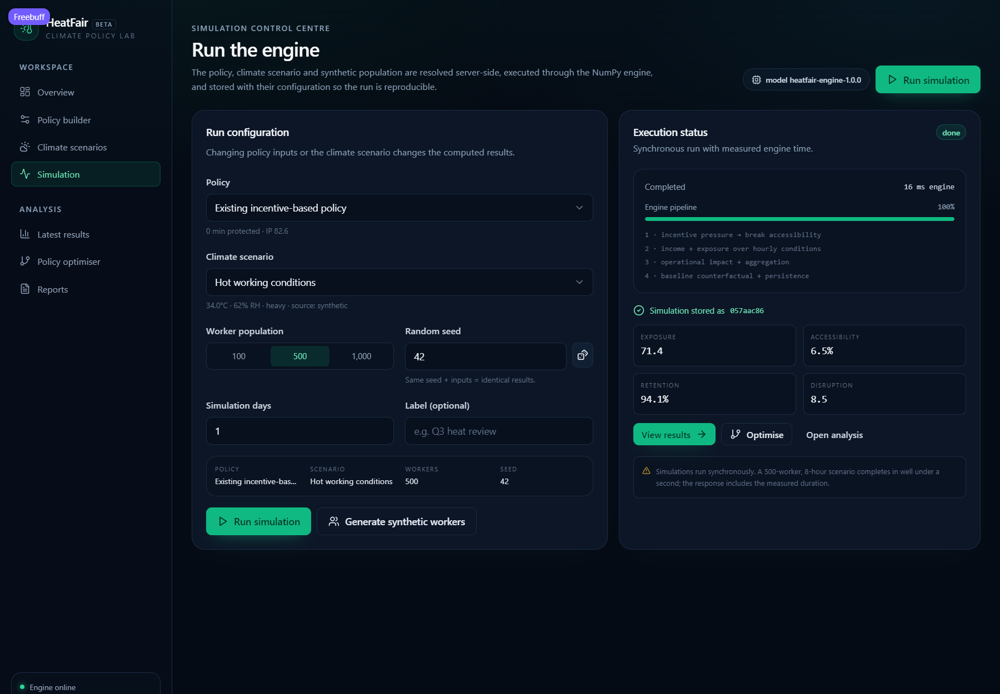
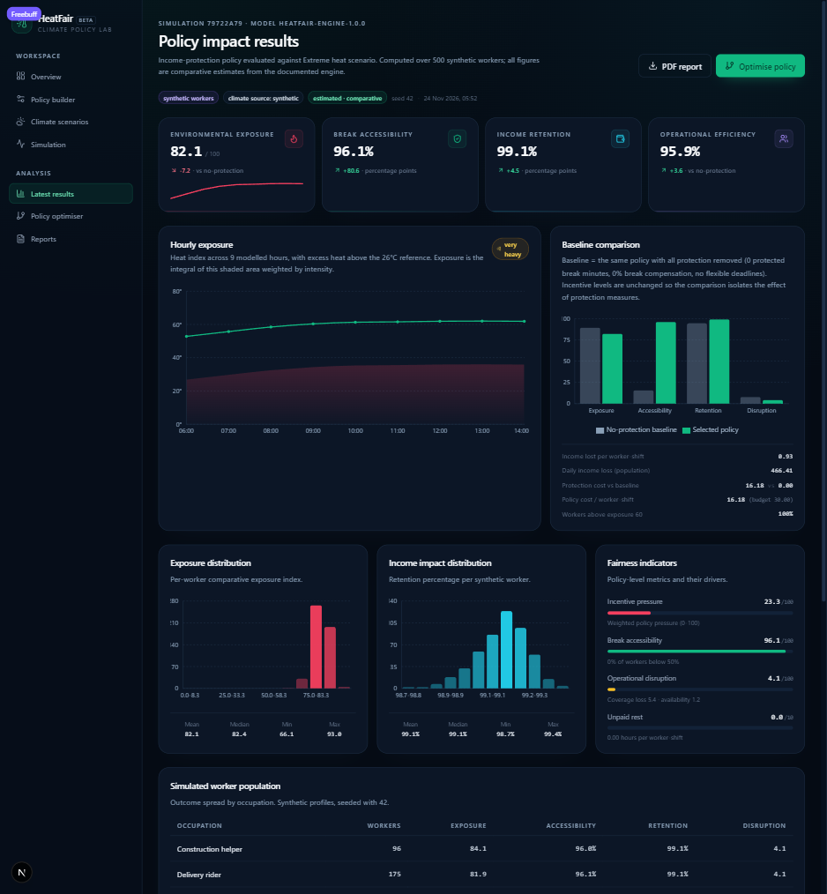
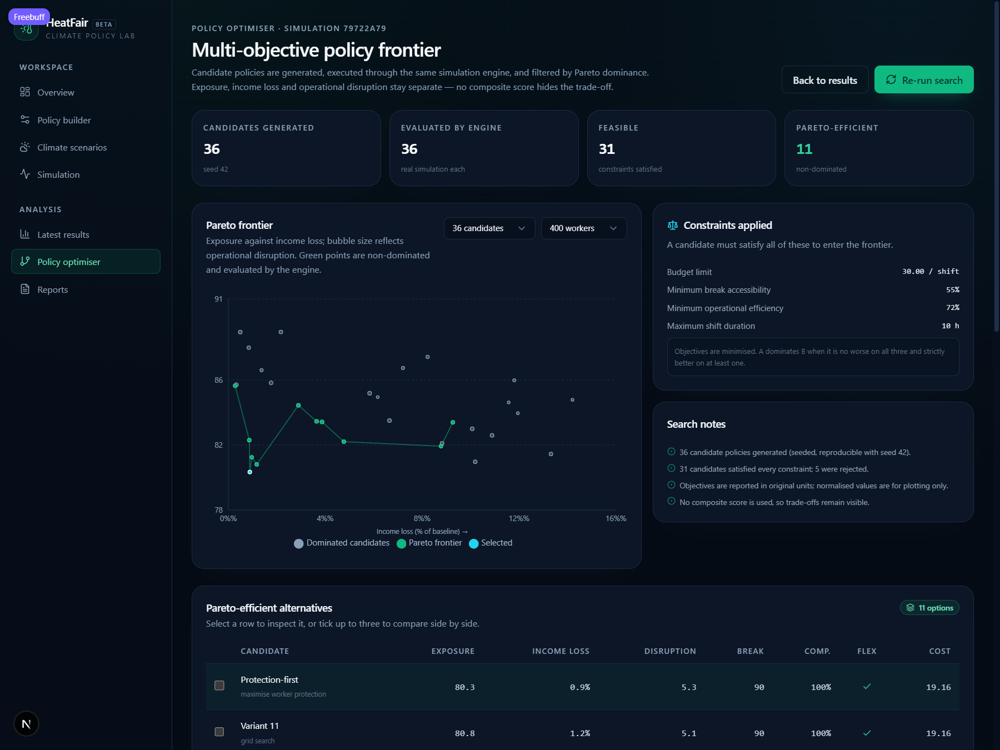

# HeatFair

**Climate risk shouldn't become a worker's financial burden.**

HeatFair is a live climate-aware workplace policy simulator. It lets an organisation pick a real
workplace location, pull **live Open-Meteo conditions and an hourly forecast**, then run a saved
heat policy against a synthetic outdoor workforce. It shows how **heat exposure**, **income
protection** and **operational continuity** trade against each other — with a real Pareto
optimiser and an auditable PDF report.

> **Scope and honesty.** Every worker profile is synthetic. Weather is retrieved from Open-Meteo
> and may represent modelled conditions rather than an on-site sensor; forecasts are not
> observations. Exposure uses a heat-index estimate, **not WBGT**. Model coefficients are
> illustrative and unvalidated. Outputs are comparative policy estimates, not medical advice,
> injury-prevention guidance or certified occupational-safety assessment.

> **Weather applications tell people when it is hot. HeatFair helps organizations understand
> whether their workplace policies make working in that heat harder for workers — and what they
> can change.**



---

## Contents

- [Problem](#problem)
- [Solution](#solution)
- [Innovation](#innovation)
- [Architecture](#architecture)
- [Technology stack](#technology-stack)
- [Mathematical methodology](#mathematical-methodology)
- [Installation](#installation)
- [Screenshots](#screenshots)
- [Demo](#demo)
- [API](#api)
- [Testing](#testing)
- [Database](#database)
- [Deployment](#deployment)
- [Performance](#performance)
- [Limitations](#limitations)
- [Future scope](#future-scope)
- [Team contributions](#team-contributions)
- [Repository structure](#repository-structure)

---

## Problem

Outdoor work is increasingly heat-constrained, and the cost of resting is written into policy:

- output-linked bonuses and deadline penalties make a break feel expensive;
- unpaid protected breaks transfer heat risk directly into lost income;
- organisations cannot see how a break entitlement interacts with incentive design until the
  season is over;
- generic dashboards show heat or headcount, not the **policy → exposure → income → operations**
  chain that a decision actually depends on.

## Solution

A four-step loop, fully implemented:

1. **Location and live weather** — city/address search, browser geolocation, latitude/longitude
   and a map. The server geocodes with Open-Meteo and retrieves current plus hourly forecast
   variables (temperature, humidity, apparent temperature, wind, gusts, radiation, cloud,
   precipitation) with `timezone=auto`. The UI labels data as **live modelled weather**, shows
   the provider timestamp and retrieval time, and supports refresh, 15-minute auto-refresh,
   stale-data warnings, errors and retry. It never substitutes fabricated readings.
2. **Policy builder** — deadline pressure, bonus dependency, penalty severity, break
   compensation, protected break minutes, deadline flexibility, paid breaks, safety-delay
   exemptions, maximum shift duration and operational budget. Create, update, duplicate and
   delete policies with validation.
3. **Simulation control centre** — 100 / 250 / 500 / 1,000 synthetic workers, work start/end,
   fixed seed, policy and location. The backend fetches weather, stores an immutable snapshot,
   generates synthetic workers, runs the engine, persists configuration and results, and reports
   the measured duration. Loading stages correspond to real requests, not invented progress.
4. **Results, Pareto optimiser and reports** — metrics, hourly series, distributions, baseline
   deltas, genuine frontier computed from every evaluated candidate, side-by-side policy
   comparison, and a ReportLab PDF with provenance and limitations.

Every interactive element calls the API. No metric is hard-coded.

## Live weather and provenance

Open-Meteo is the only weather source. The backend geocodes the selected place, requests current
and hourly variables for the chosen shift with `timezone=auto`, and returns both the provider's
timestamp and HeatFair's retrieval timestamp. Every simulation stores a `weather_snapshots` row
containing the exact location, coordinates, timezone, source, retrieval time, source timestamp,
weather type, forecast date and raw current/hourly payload used.

The interface is explicit about what the data is:

- **Current** means the provider's current modelled conditions — not a sensor at the workplace.
- **Forecast** means modelled future hours — not observed future conditions.
- **Stale** is shown when the last successful retrieval is older than the freshness threshold.
- If retrieval fails, the error and last successful snapshot are shown; sample weather is never
  silently substituted.

Server responses are cached for 15 minutes (`WEATHER_CACHE_SECONDS`) to limit API calls. The
weather page can refresh on demand and auto-refreshes approximately every 15 minutes.

## Innovation

- **Policy-sensitive exposure.** Exposure is not just weather: accessible protected breaks and
  flexible scheduling reduce the excess-heat integral, so the exposure objective actually
  responds to policy.
- **Multi-objective by design.** Three objectives, no composite score. Candidates are generated,
  executed through the same engine as a user simulation, and filtered by dominance.
- **Audit trail in every direction.** Coefficients, formulas, seeds, scenario provenance and
  model version travel with each result, appear in the UI and are printed in the PDF.
- **Determinism as a feature.** Same policy, scenario and seed reproduce identical numbers,
  which is what makes a policy comparison defensible.

## Architecture

```
Next.js (App Router, TS, Tailwind, shadcn/ui, Recharts)
    │  fetch /api/v1/*
    ▼
FastAPI  api → schemas → services → weather/optimizer → engine
    │                            │
    │                            └─ Open-Meteo geocoding + forecast
    ▼
SQLAlchemy → SQLite (local) / PostgreSQL + Supabase (managed)
```

The engine (`backend/app/engine/`) is pure NumPy with no framework dependencies: exposure,
incentive pressure, break accessibility, income, operational impact, worker generation,
aggregation and the orchestrator. The optimiser (`backend/app/optimizer/`) builds candidates and
applies Pareto dominance. Full detail: [`docs/architecture.md`](docs/architecture.md).

## Technology stack

| Layer | Choice |
| --- | --- |
| Frontend | Next.js 15 (App Router), TypeScript, Tailwind CSS, shadcn/ui primitives (Radix + CVA), Lucide, Recharts, React Hook Form, Zod |
| Backend | Python, FastAPI, Pydantic v2, NumPy, Pandas/SciPy (available for analysis), SQLAlchemy |
| Reports | ReportLab (server-side PDF) |
| Database | PostgreSQL / Supabase in production; SQLite for local development and the demo |
| Weather | Open-Meteo geocoding + forecast API (no key, 15-minute server cache) |
| Deployment target | Frontend Vercel, backend Render, database Supabase (see [Deployment](#deployment)) |

## Mathematical methodology

Full derivation, units and coefficient tables: [`docs/mathematical_model.md`](docs/mathematical_model.md).

**Exposure** (heat index via NWS/Rothfusz, explicitly *not* WBGT):

```
E = Σ_h duration_h · m(intensity) · max(0, HI_h − T_ref) · exposure_share · s_flex
index = 100 · (1 − exp(−E / (shift_hours · 20)))
```

**Incentive pressure** (weights sum to 1):

```
IP = 0.30·deadline + 0.30·bonus + 0.25·penalty + 0.15·(1 − break_compensation)
```

**Break accessibility** (logistic, illustrative coefficients):

```
z = b0 + b1·protected_coverage + b2·break_compensation − b3·IP_eff − b4·workload_pressure
A = 1 / (1 + exp(−z))
```

**Income** — baseline vs alternative, with explicit no-double-counting rules:

```
alternative = wage·worked_hours + break_pay + bonus_alt − penalty
retention   = 100 · alternative / baseline
```

**Operational disruption:**

```
disruption = 0.60·coverage_loss + 0.25·workload_pressure + 0.15·availability_loss
```

**Optimisation:** minimise {exposure, income loss, disruption}; candidate `a` dominates `b` iff
`a ≤ b` on all objectives and `<` on at least one. Constraints: budget, minimum break
accessibility, minimum operational efficiency, maximum shift duration.

Reproduce the documented worked example:

```bash
cd backend
.venv/Scripts/python.exe scripts/reproduce_example.py      # Windows
.venv/bin/python scripts/reproduce_example.py              # macOS/Linux
```

## Installation

### Prerequisites

- Python 3.11+ (verified on 3.14)
- Node.js 20+ **or** Bun 1.1+ (the repo was built with Bun 1.4)
- No database server required for the demo (SQLite)

### 1. Backend

```bash
cd heatfair/backend
python -m venv .venv

# Windows
.venv/Scripts/python.exe -m pip install -r requirements.txt
# macOS / Linux
.venv/bin/python -m pip install -r requirements.txt

# Windows
.venv/Scripts/python.exe -m uvicorn app.main:app --reload --host 127.0.0.1 --port 8000
# macOS / Linux
.venv/bin/python -m uvicorn app.main:app --reload --host 127.0.0.1 --port 8000
```

On first start the API creates the database, seeds the fictional organisation, three policies,
three climate scenarios, 500 synthetic workers and one completed demo simulation.

- API: <http://127.0.0.1:8000>
- Swagger: <http://127.0.0.1:8000/docs>
- Health: <http://127.0.0.1:8000/api/v1/health>

### 2. Frontend

```bash
cd heatfair/frontend
bun install        # or: npm install
bun run dev        # or: npm run dev
```

Open <http://localhost:3000>. If the backend runs elsewhere, copy
`frontend/.env.local.example` to `frontend/.env.local` and set `NEXT_PUBLIC_API_URL`.

### 3. Optional: Postgres / Supabase

```bash
psql "$DATABASE_URL" -f database/schema.sql
psql "$DATABASE_URL" -f database/seed.sql
# then set DATABASE_URL in backend/.env and restart the API
```

For the exact engine population, prefer `POST /api/v1/workers/generate` over the approximate
SQL seed. Never expose a Supabase service-role key to the frontend.

## Screenshots

Dashboard — live metrics from the latest stored simulation:



Simulation control centre — configuration, execution state and stored result:



Results — KPI deltas, hourly exposure, distributions and model transparency:



Policy optimiser — real Pareto frontier from engine evaluations:



## Demo

- Walkthrough script: [`demo/demo-script.md`](demo/demo-script.md)
- API walkthrough: `bash demo/api-walkthrough.sh` (backend running)
- Pitch outline: [`presentation/pitch-outline.md`](presentation/pitch-outline.md)
- Demo video: **not recorded in this repository.** Record the flow in `demo/demo-script.md`
  and add the link here before submission.

Seeded demo data (all illustrative):

| Entity | Values |
| --- | --- |
| Organisation | Meridian Logistics (fictional) |
| Policies | Existing incentive-based · Protected-break · Income-protection |
| Scenarios | Normal (27 °C, 52 % RH) · Hot (34 °C, 62 % RH) · Extreme (40 °C, 55 % RH) |
| Workers | 500 synthetic profiles, seed 42 (`data/sample_workers.json`) |

Representative results (500 workers, seed 42, hot scenario):

| Policy | Exposure | Accessibility | Retention | Disruption | Cost/shift |
| --- | --- | --- | --- | --- | --- |
| Existing incentive-based | 71.4 | 6.5 % | 94.1 % | 8.5 | 0.00 |
| Protected-break | 63.8 | 81.6 % | 93.7 % | 3.6 | 6.47 |
| Income-protection | 61.8 | 96.1 % | 99.1 % | 4.1 | 16.18 |

## API

Base path `/api/v1`. Validation errors return `422` with field detail; conflicts return `409`.

| Method | Endpoint | Purpose |
| --- | --- | --- |
| GET | `/health` | liveness + database check |
| POST | `/organizations` | create organisation |
| GET | `/organizations` · `/organizations/{id}` | list / read |
| POST | `/policies` | create policy |
| GET | `/policies?organization_id=` | list (with incentive index) |
| PUT | `/policies/{id}` | update |
| DELETE | `/policies/{id}` | delete (blocked while used by a simulation) |
| GET | `/weather/geocode?query=` · `/weather/search?query=` | Open-Meteo geocoding |
| GET | `/weather/current?latitude=&longitude=` | current modelled conditions |
| GET | `/weather/hourly?latitude=&longitude=` | hourly forecast variables |
| GET | `/weather/forecast?latitude=&longitude=&shift_start=&shift_end=&date=` | shift-aligned forecast |
| POST | `/workers/generate` | generate + persist synthetic population |
| POST | `/simulations/run` | run against a stored weather snapshot (legacy scenario path also supported) |
| GET | `/simulations` · `/simulations/{id}` | history / metadata |
| GET | `/simulations/{id}/results` | stored results |
| GET | `/simulations/{id}/weather` | provenance for the snapshot used |
| POST | `/simulations/{id}/optimize` | generate, evaluate, Pareto-filter |
| GET | `/simulations/{id}/pareto` | stored frontier |
| POST | `/simulations/{id}/apply` | create policy from candidate + re-run |
| GET | `/simulations/{id}/report` | generate and download PDF |
| GET | `/reports` · `/reports/download/{file}` | report records / files |
| GET | `/dashboard?organization_id=` | aggregated dashboard payload |
| GET | `/demo/bootstrap` | demo org, policies, scenarios, latest run |

Live run example (coordinates and shift hours only — the backend fetches the weather, stores the
snapshot and never accepts client-supplied readings):

```bash
curl -X POST http://localhost:8000/api/v1/simulations/run \
  -H "Content-Type: application/json" \
  -d '{"organization_id":"<org>","policy_id":"<policy>",
       "latitude":13.0827,"longitude":80.2707,"location_name":"Chennai",
       "population_size":250,"random_seed":42,
       "work_start_hour":6,"work_end_hour":14}'
```

Legacy scenario runs accept `scenario_id` instead and are retained for reproducible tests.

## Testing

```bash
cd backend
.venv/Scripts/python.exe -m pytest -q     # Windows
.venv/bin/python -m pytest -q             # macOS/Linux
```

**90 tests, all passing** (≈3 s). Coverage includes:

- exposure (formula match, reference cut-off, intensity, breaks, flexibility, bounds)
- incentive pressure (weights, bounds, compensation effect, breakdown reconstruction)
- break accessibility (logistic bounds, monotonicity in every driver, extreme inputs)
- income (no double counting, retention identity, penalty, zero-shift guard)
- operational impact (range, monotonicity, availability cap, cost components)
- worker generation (determinism, supported sizes, documented ranges)
- aggregation (percentile order, empty/NaN, histogram totals)
- Pareto dominance (definition, ties, frontier, normalisation)
- constraints (budget, protection floor, capacity, shift length, deterministic generation)
- reproducibility (identical inputs → identical metrics and frontier)
- API end-to-end (run → results → optimise → apply → PDF, validation, 404s, CORS)

Frontend build/typecheck: `cd frontend && bun run build`.

## Database

Nine tables with foreign keys, checks and indexes: `organizations`, `policies`, `scenarios`,
`worker_profiles`, `weather_snapshots`, `simulations`, `simulation_results`,
`policy_candidates`, `reports`. DDL: [`database/schema.sql`](database/schema.sql). Seed:
[`database/seed.sql`](database/seed.sql).

`weather_snapshots` stores the exact Open-Meteo payload used and separates retrieval time from
the provider timestamp. `simulations.weather_snapshot_id` links each result to its provenance.
The FastAPI service connects with a server-side database role and scopes every query by
`organization_id`; no Supabase service-role key is sent to the browser. For direct Supabase
client access, apply [`database/rls.sql`](database/rls.sql) after wiring Supabase Auth and
populating `organization_members`. The hackathon demo itself has no sign-in.

## Deployment

Target topology: **Vercel** (frontend) + **Render** (FastAPI) + **Supabase** (Postgres).

**Status: prepared, not executed.** No deployment was performed from this workspace because it
requires the owner's Vercel/Render/Supabase accounts and credentials. The repository is ready:

1. **Database** — create a Supabase project, run `database/schema.sql`, then `database/seed.sql`.
   Apply `database/rls.sql` only when Supabase Auth and organisation membership are wired.
2. **Backend** — create a Render web service from `backend/` using `backend/render.yaml`
   (or: build `pip install -r requirements.txt`, start
   `uvicorn app.main:app --host 0.0.0.0 --port $PORT`). Set `DATABASE_URL`,
   `CORS_ORIGINS=https://<your-vercel-domain>`, `AUTO_SEED_DEMO=true`. Health check:
   `/api/v1/health`.
3. **Frontend** — import `frontend/` into Vercel, set
   `NEXT_PUBLIC_API_URL=https://<your-render-service>`, deploy. On the free tier, wake the
   Render service before a demo (cold start ~30 s).
4. **Verify** — open `/dashboard`, run a simulation, optimise, download a report.

Deployment link: **not available** until step 2–3 are completed by the owner. Add it here once
live.

## Performance

- 250–500 synthetic workers over an 8-hour shift: ~15–25 ms engine time.
- 1,000 workers: ~20–50 ms.
- 48-candidate Pareto search: ~100–200 ms.
- No background queue: the request is fast enough to stay synchronous, and the API returns the
  measured duration for transparency.
- Open-Meteo responses are cached in-process for 15 minutes; the UI avoids redundant fetches by
  loading the demo workspace once.
- All engine calculations are vectorised over the population with NumPy.

## Limitations

- **Synthetic populations.** Distributions are plausible, not measured. Results describe no
  specific real workforce.
- **Heat index, not WBGT.** No solar load, wind, clothing or metabolic rate. Not a substitute for
  a workplace heat-stress assessment.
- **Illustrative coefficients.** The accessibility logistic and incentive weights are unvalidated
  assumptions. They produce sensible ordering, not measured effect sizes.
- **Accounting-style income model.** No tax, benefits, overtime premia or contractual penalties.
- **Weather scope.** Live weather is Open-Meteo modelled data for a grid location, not an
  on-site sensor. The selected shift uses the provider's hourly forecast; conditions can differ
  at the exact workplace and change after retrieval.
- **Single representative shift.** `simulation_duration_days` is stored, but the engine evaluates
  one day; no acclimatisation or adaptive behaviour.
- **Illustrative costs.** Backfill and compensation costs exclude recruitment, overtime and
  service credits.
- **No authentication in the demo build.** Organisation scoping is by request parameter; RLS is
  documented but not enabled.
- **External dependency.** Live weather requires network access to Open-Meteo. Failures are
  explicit, retryable and never replaced with invented readings.
- **Not deployed from this workspace.** See [Deployment](#deployment).

## Future scope

1. Calibrate the accessibility model with observed break-taking and WBGT measurements.
2. Replace the accounting income model with payroll-calibrated earnings.
3. Multi-day simulation with acclimatisation, seasonality and adaptive scheduling.
4. Supabase Auth + RLS for true multi-tenant use, with audit logs.
5. Additional objectives (e.g. equity gap between occupations) and NSGA-II refinement.
6. Field pilot with a pre-registered comparison between two policies.

## Team contributions

Replace the placeholders with the actual team before submission.

| Area | Owner | Contribution |
| --- | --- | --- |
| Simulation engine & tests | _TBD_ | exposure, incentive, accessibility, income, operational models; 90 tests |
| Optimiser | _TBD_ | candidate generation, dominance, constraints, frontier persistence |
| Backend & database | _TBD_ | FastAPI surface, schemas, SQLAlchemy models, schema/seed SQL |
| Frontend | _TBD_ | App Router pages, design system, charts, API integration |
| Reports & documentation | _TBD_ | ReportLab PDF, architecture/model/methodology docs, demo script |

## Repository structure

```
heatfair/
  frontend/            Next.js app (app/, components/, lib/)
  backend/
    app/
      api/             HTTP routers
      engine/          simulation modules (pure NumPy)
      optimizer/       candidate search + Pareto dominance
      services/        orchestration, reports, insights, seeding, weather
      schemas/         Pydantic models
    tests/             90 pytest tests
    scripts/           reproduce_example.py, export_sample_data.py
  database/            schema.sql, seed.sql
  data/                sample_workers.json (500), climate_scenarios.json
  docs/                architecture.md, mathematical_model.md, methodology.md, screenshots/
  presentation/        pitch-outline.md
  demo/                demo-script.md, api-walkthrough.sh
  .env.example
  README.md
```

## Licence

Created for a hackathon submission. Add the licence your team intends before publishing.
